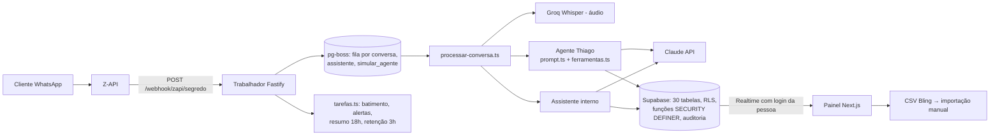
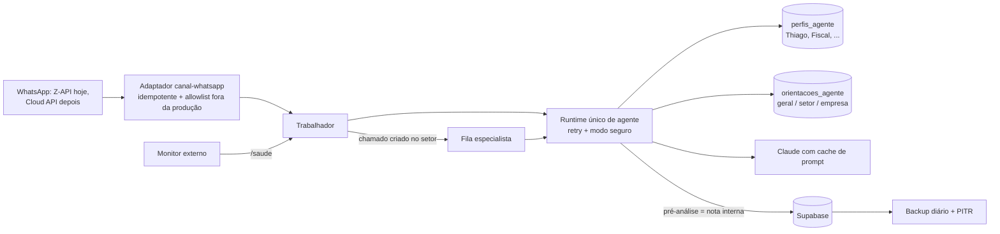

# Análise de Arquitetura — Sistema do Escritório (agente "Thiago")

Base: documento "Arquitetura do sistema do escritório", retrato de 01/10/2026 (lido por completo).
Suposição: o código é montado com **Claude Code** (há `docs/superpowers/specs e plans`, branches e worktrees). Se for outra ferramenta, me avise que eu adapto os prompts.

---

## 1. Resumo executivo

O sistema está **acima da média**: o banco decide o acesso (RLS), as gravações passam por funções fechadas, há auditoria, teto de gasto com IA, fila no próprio Postgres, confirmação com chave de conferência e cerca de 860 testes, incluindo 43 cenários com o Claude real. **Não é caso de reescrever nada.**

O maior risco está em **ir para produção sem ter resolvido três pontos**:
1. O agente falha em 1 de cada 25 conversas, e não há um comportamento definido para quando a IA cai ou os créditos acabam (o cliente fica sem resposta).
2. Todo o monitoramento roda dentro do próprio trabalhador: se ele cair, ninguém é avisado.
3. Há travas de dados incompletas justamente em preço e pedido de nota, que viram nota fiscal.

A maior oportunidade é o **agente especialista por setor**. Ele deve ser montado como um perfil configurável sobre o mesmo motor, e não como um segundo agente copiado.

---

## 2. Como está hoje



**Caminho da demanda:** chega mensagem → espera 8 s → fila → o agente decide (expediente, pausa, atendente, teto) → responde ou abre demanda no setor → atendente assume, responde, transfere ou conclui. No pedido de nota: resumo → "confirmo" → demanda no Fiscal com `pedido_venda` → CSV do Bling.

**O que já está bem feito (manter):**
- RLS com `pode_ver_*`, `meus_setores`, `tem_permissao`, e gravações só por funções.
- Teto de IA, `uso_ia` e `decisoes_agente` (sabe-se o que a IA fez e quanto custou).
- Chave de conferência no pedido de nota e na correção do assistente.
- Treinar o agente com versões, regras fixas acima das orientações e teste que finge as gravações.
- Texto do cliente marcado como não confiável, o que protege contra instruções escondidas.
- Testes em todas as camadas, inclusive cenários com IA real.

---

## 3. Diagnóstico

| # | Sev. | Problema | Impacto | Correção |
|---|---|---|---|---|
| 1 | 🔴 | O agente falha em cerca de 1 a cada 25 conversas, e não existe comportamento definido para falha da API do Claude nem para fim dos créditos (aconteceu 2× em 29/09) | Cliente fica sem resposta e a conversa não chega a nenhuma pessoa | Diagnosticar e classificar as falhas, tentar de novo nos erros passageiros e, nos outros casos, entrar em "modo seguro": uma mensagem fixa ao cliente, conversa marcada como sem responsável e alerta à equipe |
| 2 | 🔴 | Batimento, alertas e `/saude` dependem do próprio trabalhador; não há monitor externo nem plano de backup para a produção | Se o trabalhador ou o WhatsApp cair de madrugada, ninguém sabe; perda de dados sem como recuperar | Monitor externo chamando `/saude` (com 503 quando algo está errado), backups diários e PITR no Supabase de produção, runbook de incidentes |
| 3 | 🟠 | A homologação usa dados reais e Z-API real (túnel cloudflared) | Ligar o agente ou rodar um teste ali pode mandar mensagem a um cliente de verdade | Lista de telefones permitidos fora da produção: `envio.ts` recusa qualquer número fora dela quando `AMBIENTE != producao` |
| 4 | 🟠 | Travas incompletas: duas alterações de preço ao mesmo tempo (a última apaga a outra), prévia do assistente conta como vista mesmo sem entrega, pergunta duplicada, gravação parcial | Preço ou pedido errado vira nota fiscal errada | Controle de versão no preço, prévia válida só após confirmação de envio, chave única por mensagem de origem, alteração em transação única |
| 5 | 🟠 | Repetição do webhook: o documento não diz se há bloqueio por id da mensagem da Z-API | Mensagem duplicada e resposta dupla ao cliente | Índice único pelo id externo e teste (se já existir, só confirmar com teste) |
| 6 | 🟠 | A Z-API não é a API oficial do WhatsApp | Risco de o número ser bloqueado; a "verificação da Meta" no plano sugere migração futura | Manter `envio.ts` e o webhook como adaptador único (`canal-whatsapp`) para trocar pela Cloud API oficial sem mexer no agente |
| 7 | 🟠 | A retenção de 1 ano apaga mensagens, incluindo o "confirmo" do cliente que originou a nota | Perde-se a prova do que o cliente pediu e confirmou | Gravar a evidência da confirmação (resumo, texto, data e hora, chave) em `chamado_eventos`, fora da limpeza de 1 ano, com prazo configurável (confirmar o prazo com o contábil/jurídico) |
| 8 | 🟡 | Branches longas: `treinar-agente` contém `etapa-1` e `redesign-painel`, e nada foi juntado | Conflitos crescem; produção montada a partir de uma branch não principal | Após seu teste, juntar, criar uma tag de versão e trabalhar em branches curtas a partir da `etapa-1` |
| 9 | 🟡 | LGPD: orientações, versões e simulações não são apagadas e guardam texto de clientes ("Ensinar o agente") | `anonimizar_contato` fica incompleto | Ligar a orientação ao `contato_id` de origem; anonimizar também apaga esses textos; permitir apagar orientação com auditoria |
| 10 | 🟡 | "Processa uma conversa de cada vez": preciso confirmar se é um limite global ou por conversa | Se for global, com 10 clientes ao mesmo tempo o décimo espera todos os outros | Paralelismo configurável (ex.: 4), mantendo 1 por conversa (`singletonKey`) |
| 11 | 🟡 | A ideia de agente por setor ainda não tem desenho | Risco de virar código duplicado e de vários agentes falando com o cliente | Ver a seção 4 |
| 12 | 🟡 | O estado do agente não aparece ao vivo; atendentes não veem pausa, teto e sinais de vida | Equipe acha que o agente está atendendo quando está parado | Visão `estado_agente` lida por todos os autenticados, com tempo real (sem expor custo) |
| 13 | ⚪ | Cache de prompt da Anthropic: o documento não diz se é usado (regras fixas + até 12 mil caracteres de orientações a cada mensagem) | Custo e tempo de resposta maiores que o necessário | `cache_control` no bloco fixo (regras + orientações) |
| 14 | ⚪ | Itens do painel: erro ao salvar fecha o formulário, faltam avisos de confirmação, documento enviado pela IA sem link | Atrito no uso diário | Pacote de ajustes rápidos |

O que **não** recomendo: microserviços, Kubernetes, framework de agentes (LangChain/LangGraph) ou multiempresa (multi-tenant). O sistema é de um escritório só e o desenho atual comporta bem esse uso.

---

## 4. Arquitetura-alvo (só o que muda)



**Agentes por setor, do jeito certo:**
- **Thiago continua sendo a única voz com o cliente.** Especialistas trabalham dentro da demanda e não falam com o cliente na v1.
- Especialista = **um registro em `perfis_agente`** (setor, objetivo, ferramentas permitidas, modelo, ativo) mais as orientações daquele setor que já existem. É o mesmo motor de execução e a mesma tela de treino.
- Saída do especialista: **pré-análise como nota interna** ("Pré-análise do agente Fiscal") e sugestões de correção no **mesmo formato de prévia com chave** do assistente. Uma pessoa aprova.
- Começar pelo **Fiscal**: conferir o pedido de nota antes do humano (campos que faltam para o Bling, preço diferente do histórico, unidades "a conferir", destinatário).

---

## 5. Plano em fases

| Ordem | Fase | Objetivo | Como validar |
|---|---|---|---|
| 0 | **Você:** testar o Treinar o agente e juntar a `treinar-agente` à `etapa-1` | Base única | Painel novo e treino na `etapa-1` |
| 1 | Confiabilidade do agente (Prompt 1) | Nenhum cliente sem resposta ou sem pessoa | Cenários com falha simulada, 0 falhas em 3 rodadas |
| 2 | Prontidão para produção (Prompt 2) | Saber quando algo cai e conseguir restaurar | Desligar o trabalhador e receber alerta externo; restaurar um backup |
| 3 | Integridade dos dados (Prompt 3) | Preço e pedido nunca errados por concorrência ou falha | Testes de concorrência e de falha de envio |
| — | **Subir a produção** | | |
| 4 | Melhorias rápidas e custo (Prompt 4) | Painel mais claro, IA mais barata | Checklist do prompt |
| 5 | Especialista Fiscal (Prompt 5) | Primeiro agente de setor | Pré-análise aparecendo nas demandas de nota |

---

## 6. Prompts prontos para colar

Cole **um por vez** no Claude Code, na branch `etapa-1` já com a `treinar-agente` juntada. Espere terminar, teste e só então passe para o próximo.

### Prompt 1 — Confiabilidade do agente de clientes

```
# CONTEXTO
Monorepo pnpm (TypeScript, Node 22). apps/trabalhador: Fastify + pg-boss. A Z-API chama POST /webhook/zapi/<segredo>; a mensagem é gravada, a conversa entra na fila após 8 s e é processada em processar-conversa.ts, que chama o agente de clientes (src/agente/prompt.ts e src/agente/ferramentas.ts) via API do Claude. Banco Supabase com RLS e funções SECURITY DEFINER. Custos em uso_ia, decisões em decisoes_agente, alertas em alertas. Testes: vitest do trabalhador e cenários com Claude real em src/cenarios/.

Problemas conhecidos: (1) nos testes, cerca de 1 em cada 25 conversas o agente falha; (2) em 29/09 os créditos da Anthropic acabaram duas vezes; (3) não há comportamento definido para quando a chamada ao Claude falha — o cliente provavelmente fica sem resposta e a conversa não chega a ninguém.

# OBJETIVO
Nenhuma mensagem de cliente pode ficar sem resposta E sem pessoa responsável, mesmo quando a IA falha.

# O QUE FAZER
1. Diagnóstico primeiro (use a skill de systematic-debugging): rode os cenários várias vezes, colete cada falha e classifique a causa (429/529/5xx/timeout da API, saldo esgotado, tool_use ou JSON inválido, exceção dentro de ferramenta, limite de rodadas, erro de envio na Z-API, outro). Salve o relatório em docs/relatorios/falhas-agente.md.
2. Corrija cada causa encontrada com um teste que reproduz o problema antes da correção.
3. Política de falha em processar-conversa.ts:
   a. Erros passageiros (429, 529, 5xx, timeout): nova tentativa com espera crescente e aleatoriedade (ex.: 3 tentativas — 2 s, 8 s, 30 s), respeitando o cabeçalho retry-after.
   b. Erros definitivos (saldo/billing, 401, teto de IA atingido, tentativas esgotadas): "modo seguro" — enviar ao cliente uma mensagem fixa e curta (texto editável em configuracoes, chave mensagem_modo_seguro, padrão: "Recebi sua mensagem. Já vou verificar e te retorno.") no máximo 1 vez por conversa a cada 4 horas; deixar a conversa como sem responsável na caixa_entrada; criar alerta para o admin e para os atendentes do setor, quando houver setor conhecido.
   c. Nunca mandar ao cliente texto de erro técnico.
4. Webhook idempotente: garanta deduplicação pelo id da mensagem da Z-API (índice único no id externo em mensagens). Webhook repetido responde 200 sem duplicar mensagem nem gerar nova resposta. Se já existir, apenas acrescente o teste.
5. Registre cada falha (tipo, tentativa, erro resumido, conversa_id, modelo) — em decisoes_agente ou numa tabela nova falhas_agente com RLS só para admin. Mostre no Início o contador "Falhas do agente hoje".
6. pg-boss: configure retryLimit, retryBackoff e expireIn nos jobs de conversa; um job que falhou não pode travar a fila daquela conversa.
7. Verifique a concorrência: se hoje o trabalhador processa uma conversa por vez no total, passe a processar N em paralelo (configuracoes.concorrencia_agente, padrão 4), mantendo no máximo 1 job por conversa (singletonKey).

# REGRAS
- Não mude prompt.ts nem as regras fixas do agente.
- Migrações novas em supabase/migrations com teste pgTAP; não apague dados existentes.
- TDD: teste falhando primeiro, depois a correção.
- Ao final rode todas as suítes (painel test, painel e2e, trabalhador test, core, db, supabase test db) e os cenários.

# CRITÉRIOS DE ACEITE
- [ ] Teste com a API simulando 529 em todas as tentativas: o cliente recebe UMA mensagem de modo seguro, a conversa fica sem responsável e há alerta.
- [ ] Teste com saldo esgotado: mesmo resultado, sem ficar repetindo tentativas.
- [ ] Webhook enviado duas vezes não gera mensagem nem resposta duplicada.
- [ ] Cenários reais: 0 falhas em 3 rodadas completas, ou falhas restantes documentadas com causa e plano.
- [ ] Todas as suítes passando.

# FORA DO ESCOPO
Agentes por setor, montagem da produção, mudanças visuais no painel.
```

### Prompt 2 — Prontidão para produção

```
# CONTEXTO
Mesmo monorepo (apps/painel Next.js 15, apps/trabalhador Fastify + pg-boss, Supabase). Ambientes: local (Docker), homologação (Supabase na nuvem com dados reais, Z-API real via túnel cloudflared) e produção (a montar em Easypanel ou Hostinger, variável AMBIENTE=producao). Hoje o batimento (sinais_vida), os alertas e GET /saude rodam dentro do próprio trabalhador: se ele cair, ninguém é avisado.

# OBJETIVO
Deixar o sistema pronto para produção: saber quando algo cai, não mandar mensagem a cliente real fora da produção e conseguir restaurar os dados.

# O QUE FAZER
1. Trava de envio fora da produção: em envio.ts, quando AMBIENTE != 'producao', só enviar para telefones de uma lista permitida (variável TELEFONES_PERMITIDOS ou tabela em configuracoes). Envio bloqueado é registrado em log e em decisoes_agente, sem erro para o fluxo. Teste cobrindo os dois casos.
2. GET /saude completo: responde 200 só se (a) o banco responde, (b) o último batimento tem menos de 3 min, (c) a instância da Z-API está conectada, (d) não há job da fila de conversa esperando há mais de 5 min. Caso contrário 503 com JSON dizendo o que falhou (sem segredos). Proteja os detalhes com um token opcional (SAUDE_TOKEN).
3. Webhook: o segredo da URL não pode aparecer em logs (mascarar no logger do Fastify). Se a Z-API permitir um token de segurança em cabeçalho, valide também o cabeçalho. Documente como trocar o segredo.
4. Deploy: Dockerfile para o trabalhador e para o painel (multi-stage, Node 22, pnpm), docker-compose de exemplo para o Easypanel, .env.producao.example com todas as variáveis comentadas (sem valores reais), chaves da Anthropic separadas por ambiente.
5. Migrações: script pnpm db:producao:previa (supabase db push --dry-run) e pnpm db:producao:aplicar, com confirmação. Inclua supabase/dados/setores-novos.sql e o seed das orientações como passos explícitos.
6. Backup: documente como ligar backups diários e PITR no Supabase de produção. Crie um script de backup extra semanal (pg_dump + cópia dos buckets anexos e documentos) e um script de restauração testado no ambiente local.
7. Escreva docs/producao.md com: checklist de subida (Supabase, Z-API producao, recarga automática da Anthropic, AMBIENTE, setores, seed, monitor externo) e o que fazer quando: o WhatsApp desconecta, os créditos acabam, o trabalhador cai, é preciso restaurar backup, é preciso pausar tudo.
8. No docs/producao.md, oriente configurar um monitor externo (UptimeRobot ou Better Stack, gratuito) chamando /saude a cada 1 min e avisando por e-mail e por um WhatsApp/Telegram que NÃO dependa da Z-API do sistema.

# REGRAS
- Nada de valores reais de chaves ou senhas em arquivos versionados.
- Não altere regras de negócio, telas ou prompt do agente.
- Testes para a trava de envio e para o /saude; rode todas as suítes ao final.

# CRITÉRIOS DE ACEITE
- [ ] Na homologação, enviar para um número fora da lista é bloqueado e registrado.
- [ ] Parar o trabalhador faz o /saude ficar indisponível; desconectar a Z-API faz /saude responder 503.
- [ ] O segredo do webhook não aparece nos logs.
- [ ] docker build dos dois apps funciona localmente.
- [ ] Backup e restauração testados no ambiente local, com passo a passo em docs/producao.md.

# FORA DO ESCOPO
Contratar serviços, criar contas, mudar de provedor de WhatsApp.
```

### Prompt 3 — Integridade dos dados (preço, pedido de nota, assistente, LGPD)

```
# CONTEXTO
Supabase com gravações só por funções SECURITY DEFINER (definir_preco, definir_preco_agente, registrar_resposta etc.) e auditoria. Assistente interno em apps/trabalhador/src/assistente/: alterar_pedido_venda mostra prévia com chave de conferência e grava ao receber "sim". Pedido de nota do agente: resumo → "confirmo" → abrir_pedido_nota com pedido_venda no chamado. Retenção (retencao.ts) apaga mensagens, arquivos, decisoes_agente e assistente_mensagens com mais de 1 ano. Treinar o agente: orientacoes_agente, orientacoes_agente_versoes, simulacoes_agente; "Ensinar o agente" copia mensagens do cliente para a orientação.

Problemas conhecidos: duas alterações de preço ao mesmo tempo — a última apaga a outra sem aviso; a prévia do assistente conta como vista mesmo se o envio falhou; pergunta duplicada no WhatsApp quando o agendamento falha; gravação parcial reportada como falha; retenção de 1 ano apaga o "confirmo" do cliente que originou a nota; anonimizar_contato não limpa orientações, versões e simulações.

# OBJETIVO
Preço e pedido de nota nunca ficam errados por concorrência ou falha, a prova da confirmação do cliente é preservada e a LGPD cobre os textos do treino.

# O QUE FAZER
1. Preço com controle de versão: coluna versao (int) em precos; definir_preco e definir_preco_agente recebem a versão esperada e falham com erro identificável (ex.: 'conflito_versao') se mudou. O painel mostra "Alguém mudou este preço agora há pouco. Recarregue para ver o valor atual." sem perder o que foi digitado.
2. Prévia só vale se entregue: a prévia do assistente só fica "apresentada" depois da confirmação de envio (painel: gravada e entregue; WhatsApp: envio aceito pela Z-API). Um "sim" para prévia não entregue responde que é preciso mostrar a prévia de novo.
3. Pergunta sem duplicar: chave única por mensagem de origem (id da Z-API ou id da mensagem do painel) na fila assistente; reagendar não cria nova pergunta.
4. Alteração atômica: toda a gravação de alterar_pedido_venda (pedido, nota interna "a pedido de Fulano", evento na linha do tempo, auditoria) numa única função do banco em transação. Ou grava tudo ou nada, e o assistente informa o resultado real.
5. Prova da confirmação do pedido de nota: ao abrir_pedido_nota, gravar em chamado_eventos um evento tipo 'confirmacao_cliente' com o resumo enviado, o texto da confirmação, data e hora, contato e chave de conferência. A retenção não apaga esses eventos; criar configuracoes.retencao_evidencias_anos (padrão 5, editável pelo admin).
6. LGPD do treino: orientacoes_agente ganha contato_origem_id (nulo quando escrita do zero); "Ensinar o agente" preenche esse campo. anonimizar_contato passa a apagar ou mascarar o texto do cliente nas orientações, versões e simulações ligadas àquele contato. Criar função apagar_orientacao (admin ou permissão treinar_agente), com auditoria, que remove a orientação e suas versões.

# REGRAS
- Migrações incrementais com testes pgTAP; preencher versao = 1 nos preços existentes.
- Gravações continuam só por funções; ninguém grava direto nas tabelas.
- TDD; rode todas as suítes e os cenários ao final.

# CRITÉRIOS DE ACEITE
- [ ] Duas abas alterando o mesmo preço: a segunda recebe o aviso de conflito e nada é sobrescrito.
- [ ] Envio da prévia falhou → "sim" não grava.
- [ ] Mesma mensagem reprocessada não gera segunda resposta do assistente.
- [ ] Falha no meio da alteração não deixa pedido pela metade.
- [ ] Toda demanda nova de pedido de nota tem evento confirmacao_cliente; a retenção de 1 ano não o apaga.
- [ ] anonimizar_contato limpa os textos daquele contato no treino (teste pgTAP).

# FORA DO ESCOPO
Visual do painel além das mensagens de erro citadas; agentes por setor.
```

### Prompt 4 — Melhorias rápidas (painel + custo da IA)

```
# CONTEXTO
Painel Next.js em apps/painel com sistema de design em src/components/{ui,patterns,layout} (ver docs/design-system.md). Estado do agente (pausa geral, teto de IA) fica em configuracoes, que só o admin lê e que não está no Realtime. sinais_vida e uso_ia também só o admin lê. Agente e assistente montam a cada mensagem regras fixas + orientações (até 12.000 caracteres).

# OBJETIVO
Equipe sempre sabe se o agente está atendendo, formulários não perdem o que foi digitado, e a IA fica mais barata e rápida.

# O QUE FAZER
1. Criar a visão ou tabela estado_agente (pausado_geral, motivo, teto_atingido, whatsapp_conectado, trabalhador_ok, atualizado_em), sem valores de custo, legível por qualquer usuário autenticado e publicada no Realtime. Atualizar via gatilho em configuracoes e sinais_vida. A barra do topo e o Início usam essa fonte e mudam ao vivo.
2. Usuários e Configurações: erro ao salvar mostra o aviso no próprio painel lateral ou cartão, sem fechar e sem perder o digitado.
3. Aviso rápido (toast) de sucesso ou erro em todas as gravações do painel, usando o componente existente.
4. Documento enviado pela IA ao cliente aparece no Atendimento com link para abrir (passando pela auditoria de download que já existe).
5. "Exportar CSV Bling" do topo respeita todos os filtros ativos da tela Demandas.
6. Custo: verificar se as chamadas ao Claude usam cache de prompt. Se não usam, marcar com cache_control o bloco estável (regras fixas + definições de ferramentas + orientações) no agente, no assistente e no simular_agente. Registrar em uso_ia os tokens de cache (cache_creation e cache_read) e calcular o custo corretamente. Mostrar no Início a economia do mês.

# REGRAS
- Seguir o design system existente (tokens e patterns); nada de cor ou componente avulso.
- Acessibilidade AA mantida; e2e e teste axe passando.
- Sem mudar regras do agente.

# CRITÉRIOS DE ACEITE
- [ ] Pausar o agente numa aba muda a barra do topo em outra aba (de atendente) sem recarregar.
- [ ] Erro forçado ao salvar um usuário mantém o painel aberto com o texto digitado.
- [ ] uso_ia registra leitura de cache e o custo por conversa cai nas mensagens seguintes de uma mesma conversa.
- [ ] Todas as suítes passando.

# FORA DO ESCOPO
Agentes por setor; assistente parte 2.
```

### Prompt 5 — Primeiro agente especialista: Fiscal

```
# CONTEXTO
Hoje existe um agente de clientes ("Thiago", src/agente/) que é a única voz com o cliente no WhatsApp, e um assistente interno (src/assistente/). Ambos usam o mesmo padrão: prompt + ferramentas + laço com o Claude + decisoes_agente/uso_ia. As orientações de treino (orientacoes_agente) já podem valer por setor. Setores: Comercial, Contábil, Direção, Financeiro, Fiscal, IRPF, Legalização, Pessoal. As demandas de pedido de nota chegam ao Fiscal com pedido_venda gravado; as regras do CSV Bling estão em packages/core/src/bling.ts.

# OBJETIVO
Criar a base para agentes especialistas por setor, SEM duplicar código, e entregar o primeiro: o especialista Fiscal, que faz uma pré-análise de cada pedido de nota antes da pessoa do Fiscal abrir.

# DECISÕES DE ARQUITETURA (seguir)
- Thiago continua a única voz com o cliente. Especialistas NÃO falam com cliente nesta versão.
- Especialista = registro de configuração, não código copiado.
- Especialista só sugere; quem grava é uma pessoa (pelo fluxo de prévia com chave que já existe no assistente).

# O QUE FAZER
1. Antes de codar, escreva a especificação e o plano em docs/superpowers (brainstorming + writing-plans) e me mostre para aprovar.
2. Tabela perfis_agente: id, setor_id, nome, objetivo (texto), ferramentas_permitidas text[], modelo, max_rodadas, ativo, versao, timestamps. RLS: leitura para quem vê o setor; gravação só por função, com permissão treinar_agente ou admin, com histórico de versões e auditoria (mesmo padrão de orientacoes_agente).
3. Extrair do agente atual um runtime genérico (ex.: src/ia/executar-perfil.ts) que recebe perfil + contexto + catálogo de ferramentas e faz o laço com o Claude, gravando decisoes_agente e uso_ia com perfil_id e setor. Agente Thiago e assistente continuam funcionando igual (os cenários atuais precisam passar sem mudança).
4. Catálogo de ferramentas com metadados: somente_leitura | grava | envia. Especialistas só recebem ferramentas somente_leitura + criar_nota_interna + sugerir_correcao (gera prévia, não grava).
5. Fila nova especialista: ao criar uma demanda num setor com perfil ativo, enfileira a pré-análise (1 por demanda, idempotente). Respeita teto de IA, pausa geral e o modo seguro do Prompt 1.
6. Especialista Fiscal v1 confere o pedido_venda: campos que faltam para o CSV Bling (reusar as validações de bling.ts), preço diferente do último preço da rede (precos com histórico), itens com unidade "a conferir", destinatário (CNPJ, endereço) incompleto. Saída: nota interna "Pré-análise do agente Fiscal" com lista objetiva (OK / atenção / falta) e, se houver correção sugerida, uma prévia que a pessoa aplica pelo assistente.
7. No painel: na linha do tempo da demanda, a pré-análise aparece com o estilo do assistente; em Treinar o agente, a tela permite escolher o perfil (Thiago ou Fiscal) para orientações e para o "Testar o agente".
8. Cenários com Claude real em src/cenarios/ para o Fiscal: pedido completo (tudo OK), faltando valor unitário, preço fora do histórico, unidade kg sem valor, e garantia de que nunca envia nada ao cliente nem grava fora da nota interna.

# REGRAS
- Nada de framework externo de agentes; reutilizar o padrão atual.
- Migrações com pgTAP; TDD; todas as suítes e cenários passando.
- Custo de cada pré-análise registrado em uso_ia com setor.

# CRITÉRIOS DE ACEITE
- [ ] Pedido de nota de teste recebe a pré-análise em até 1 min.
- [ ] Desligar o perfil Fiscal faz as novas demandas não receberem pré-análise.
- [ ] Nenhum cenário mostra o especialista enviando mensagem ao cliente ou gravando pedido.
- [ ] Cenários atuais do Thiago e do assistente continuam 100%.

# FORA DO ESCOPO
Outros setores (virão copiando só a configuração), especialista falando com cliente, assistente parte 2.
```

---

## 7. Como validar depois de cada prompt

- **Prompt 1:** pausar a internet do trabalhador ou usar uma chave inválida na homologação → o cliente de teste recebe uma única mensagem de "já te retorno", a conversa aparece sem responsável e chega o alerta.
- **Prompt 2:** parar o trabalhador → o monitor externo avisa em até 5 min. Na homologação, mandar mensagem a um número fora da lista → bloqueado e registrado.
- **Prompt 3:** duas abas mudando o mesmo preço → a segunda recebe "alguém mudou este preço, recarregue". Responder "sim" a uma prévia que não foi entregue → não grava.
- **Prompt 4:** pausar o agente numa aba → a outra aba mostra "pausado" sem recarregar.
- **Prompt 5:** abrir um pedido de nota de teste → em até 1 min aparece a nota interna "Pré-análise do agente Fiscal".
